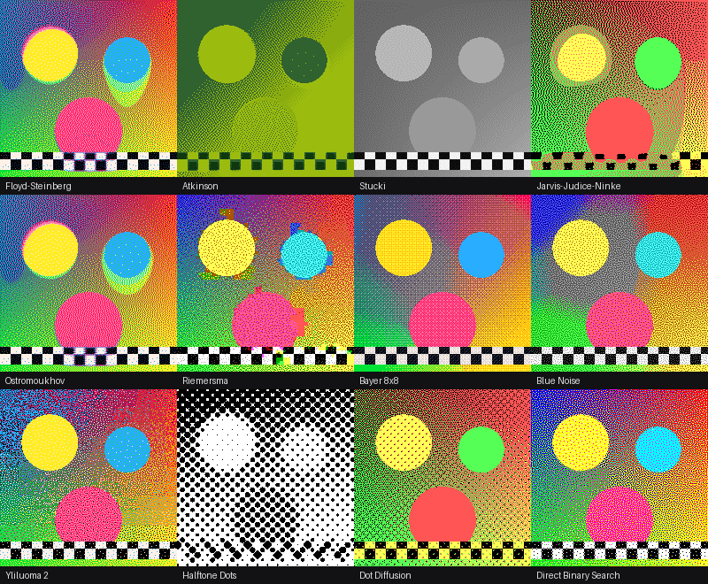

# Lattice Dither

A desktop dithering studio: 33 dithering algorithms, 9 image effects, 11 built-in palettes and a
live preview, with a one-click round trip to PhotoCraft as a new layer.

Lattice Dither is the first application of the **Lattice** suite, a family of free, open-source
image-transformation tools that share one engine and each run standalone.



*Same source image, twelve algorithms, four palettes. Top row: Floyd-Steinberg, Atkinson, Stucki,
Jarvis-Judice-Ninke. Middle: Ostromoukhov, Riemersma, Bayer 8×8, Blue Noise. Bottom: Yliluoma 2,
Halftone Dots, Dot Diffusion, Direct Binary Search.*

## Why

Most dithering tools give you Floyd-Steinberg and a Bayer matrix. Lattice Dither is built to compare
methods side by side: pick an algorithm, a palette and a pixel size, and the preview updates while
you drag a slider. When a result is good, send it back to PhotoCraft as a new layer on top of the
original.

## Features

- **33 algorithms** across four families — error diffusion, ordered, halftone and search-based.
- **9 effects** applied before or after the dither, each with its own parameters.
- **11 built-in palettes** (Game Boy, PICO-8, CGA, EGA, greys, CMYK, RGB) plus palette extraction
  from the image itself (k-means or median cut) and hand-edited palettes.
- **Live preview** rendered on a worker thread, with Before / After / Split comparison and zoom.
- **Presets** as plain JSON, navigable with the arrow keys or the toolbar buttons.
- **PhotoCraft bridge**: pull the visible document, push the result back as a new layer.
- **Numba-accelerated** inner loops; a 1024×1024 Direct Binary Search render takes about 0.7 s.

### Algorithms

| Family | Algorithms |
| --- | --- |
| Error diffusion | Floyd-Steinberg, False Floyd-Steinberg, Jarvis-Judice-Ninke, Stucki, Burkes, Sierra, Sierra Two Row, Sierra Lite, Atkinson, Stevenson-Arce, Fan, Shiau-Fan, Ostromoukhov |
| Ordered | Bayer 2×2, 4×4, 8×8, 16×16, Blue Noise, Cluster Dot 4×4, Cluster Dot 8×8, Lines Horizontal, Lines Vertical, Lines Diagonal, Yliluoma 1, Yliluoma 2 |
| Halftone | Halftone Dots, Halftone Lines, Halftone Squares |
| Other | Riemersma, Dot Diffusion, Direct Binary Search, Random, Threshold |

### Effects

Chromatic Aberration, Gaussian Blur, Glow, JPEG Glitch, Noise, Posterize, RGB Shift, Scanlines,
Sharpen.

### Palettes

`bw`, `grey_4`, `grey_8`, `grey_16`, `gameboy`, `pico8`, `cga_0_high`, `cga_1_high`, `ega`,
`cmyk_5`, `rgb_8` — plus extraction and custom palettes.

## Download

A prebuilt Windows executable is attached to the
[latest release](https://github.com/MarinWasAsleep/lattice-dither/releases/latest): download
`LatticeDither.exe` and run it, no Python installation needed. It is a PyInstaller bundle of about
146 MB, so the first window takes a few seconds to appear while it unpacks. The bundle carries its
own ffmpeg, so video export works out of the box.

## Install

Windows 11, Python 3.13 or newer.

```powershell
git clone https://github.com/MarinWasAsleep/lattice-dither.git
cd lattice-dither
python -m venv .venv
.\.venv\Scripts\python.exe -m pip install -r requirements.txt
```

That is the whole install. Video export needs ffmpeg, and `imageio-ffmpeg` ships one inside its
wheel, so there is no separate system step. If you already have a newer ffmpeg on `PATH` and prefer
it, uninstall the dependency and the export falls back to yours.

## Run

```powershell
.\.venv\Scripts\python.exe -m lattice_dither
```

Or double-click `LatticeDither.pyw`, which starts the GUI without a console window. To get Desktop
and Start Menu shortcuts:

```powershell
powershell -NoProfile -ExecutionPolicy Bypass -File scripts\install_shortcuts.ps1
```

`-Uninstall` removes them again.

## PhotoCraft integration

Lattice Dither talks to a running PhotoCraft desktop app over its local control server (TCP on
`127.0.0.1:47600`, one JSON object per line, token-authenticated). PhotoCraft must be started with
automation roots pointing at a shared exchange directory:

```
photocraft.exe --control 47600 --control-token-file "%LOCALAPPDATA%\LatticeDither\control.token" ^
  --automation-read-root <EXCHANGE_DIR> --automation-write-root <EXCHANGE_DIR>
```

**Get from PhotoCraft** saves a flattened PNG of the active document into that directory and loads
it. **Send to PhotoCraft** writes the render there and places it as a new layer above the current
one. The document itself is never modified in place, and layers, masks and blend modes are not
carried over — the bridge works on flattened pixels.

Setups created before the rename keep working: the token file and the exchange directory are still
read from `%LOCALAPPDATA%\DitherCraft\` when the new location is absent.

Without PhotoCraft, everything else works: open an image from disk and export a PNG.

## Presets

A preset is a JSON file describing the whole pipeline:

```json
{
  "version": 1,
  "algorithm_id": "yliluoma2",
  "algorithm_params": { "slots": 64 },
  "palette": {
    "source": "builtin",
    "name": "pico8",
    "colors": [],
    "extract_k": 8,
    "extract_method": "kmeans"
  },
  "pixel_size": 1,
  "brightness": 0.0,
  "contrast": 0.0,
  "gamma": 1.0,
  "pre_effects": [],
  "post_effects": [
    {
      "effect_id": "scanlines",
      "params": { "spacing": 3, "thickness": 1, "darkness": 0.45 },
      "enabled": true
    }
  ],
  "seed": 0
}
```

Twelve starter presets live in `presets/`. Use the arrows in the toolbar (or the left and right
arrow keys) to step through them.

## Adding an algorithm

Algorithms are registered by decorator, so a new one is a single function plus one line of import:

```python
from lattice_dither.core.registry import register_algorithm

@register_algorithm("my_method", "My Method", "error_diffusion", params=())
def my_method(img, palette, params):
    """Return an int32 index array of shape (H, W) into palette."""
    ...
```

The UI panel, the preset format and the parameter form pick it up automatically. The same pattern
applies to effects (`register_effect`) and palettes.

## Development

```powershell
.\.venv\Scripts\python.exe -m pytest      # 622 tests
.\.venv\Scripts\ruff.exe check .          # lint
.\.venv\Scripts\python.exe tools\check_contract.py
```

`tools/contact_sheet.py` renders an algorithm comparison grid, `tools/smoke_photocraft.py` checks a
live PhotoCraft connection.

## Layout

```
lattice_dither/
  algorithms/   error diffusion, ordered, halftone, search-based
  effects/      tone and glitch effects
  palettes/     built-in palettes, extraction, file IO
  core/         types, registry, colour maths, pipeline, presets
  bridge/       PhotoCraft control-server client
  ui/           PySide6 window, panels, canvas, render worker
presets/        starter presets
tools/          contract check, contact sheet, smoke test, icon and noise generators
tests/          622 tests
```

## License

No license file is provided yet, so the code is published for reference only. Open an issue if you
want to reuse it and we will sort out terms.
