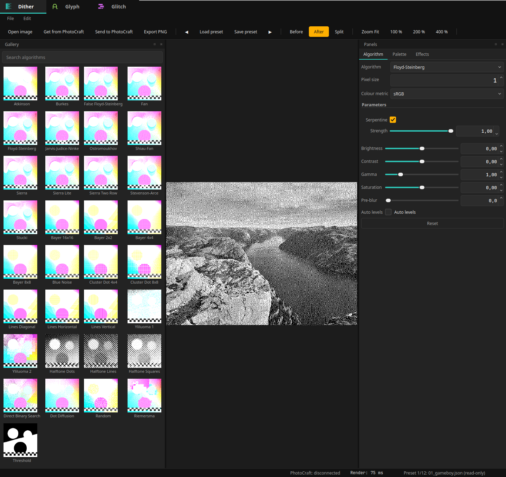
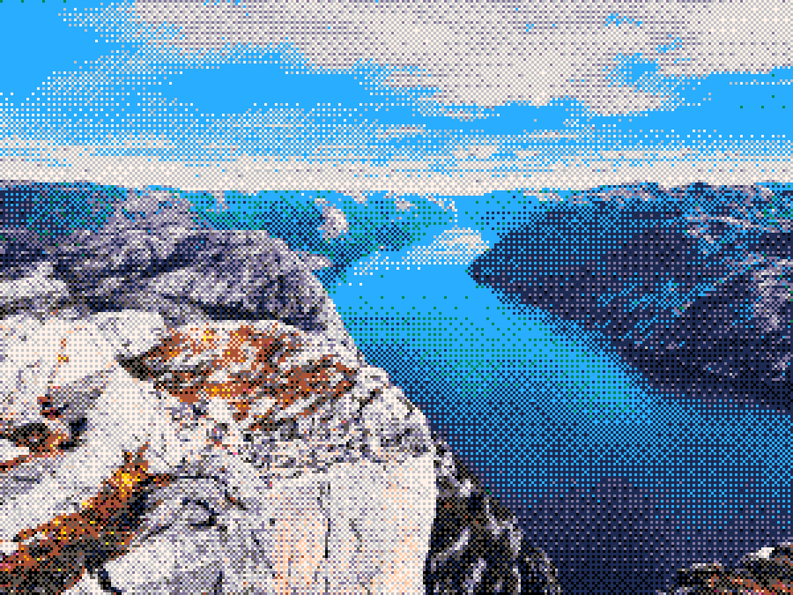
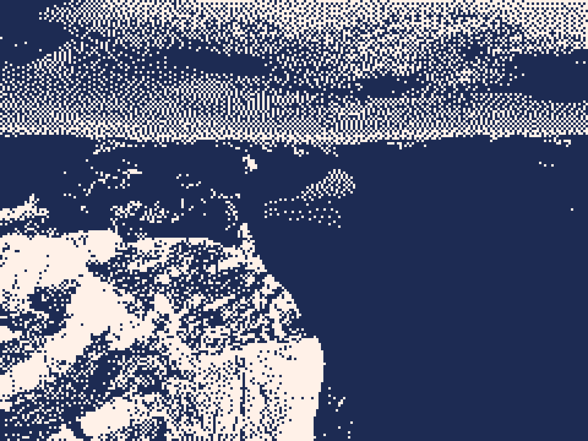
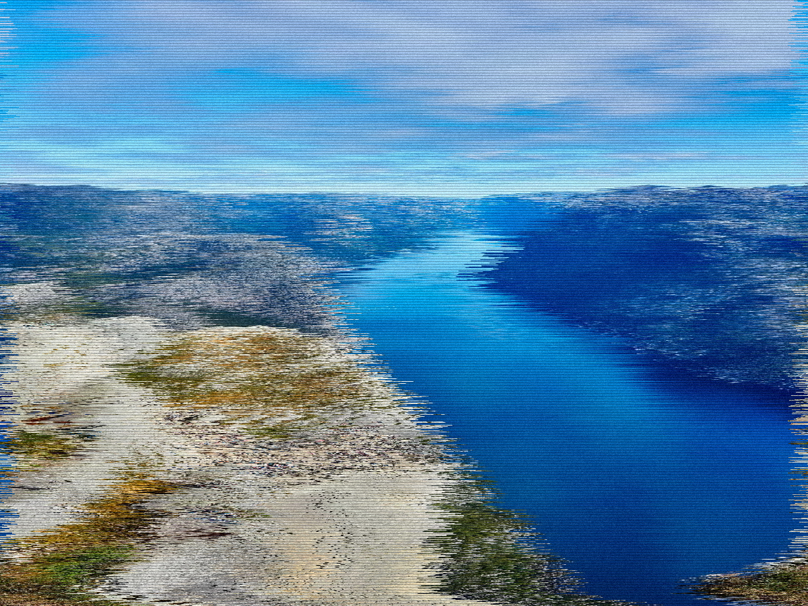
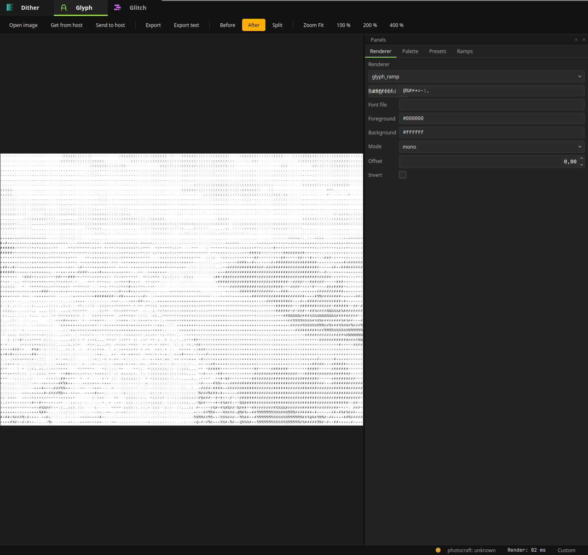
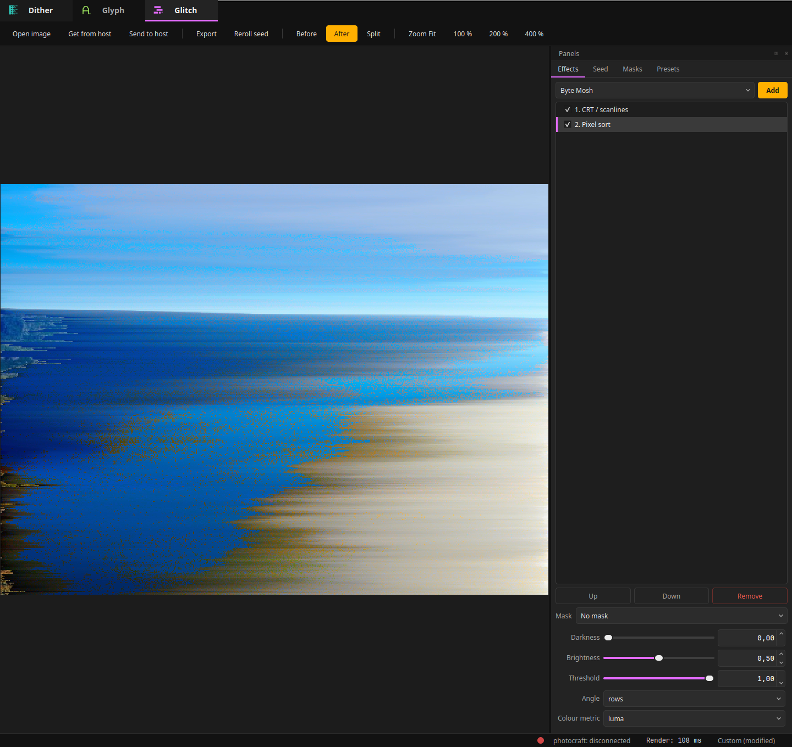

# Lattice

Lattice turns a photo into dithered pixel art, text, or glitched signal. It has three modes —
Dither, Glyph, Glitch — in one window with three tabs, and a command line so the same presets
can run in a script.

It is built for making things: pixel art, riso prints, GIFs, generative art, album covers.
The interface is dark and the image sits in the middle.

## Before / after

| Source | Dither | Glyph | Glitch |
|:---:|:---:|:---:|:---:|
|  |  |  |  |
| Original photo | Ordered dither, PICO-8 palette | Quadrant blocks, PICO-8 palette | VHS soft |

## The three modes

### Dither


More than 40 dithering algorithms, with a searchable gallery that previews each one. Error
diffusion (Floyd-Steinberg, Atkinson, Stucki, Sierra and others), ordered dithering (Bayer from
2×2 to 16×16, blue noise, cluster dot) and halftone (dots, lines, squares) are all there.

Built-in palettes: Game Boy, PICO-8, EGA, CGA, greys, CMYK, RGB — plus palette extraction from
the image itself. Pixel size, brightness, contrast, gamma and saturation are adjustable, and the
preview updates as you change them.

### Glyph



Redraws the image with glyphs: ASCII, Braille, quadrant blocks or solid shapes. In ASCII mode
you set the character ramp yourself and pick the foreground and background colours. The result
can be exported as an image or as plain text.

### Glitch



Signal degradation, built as a stack of effects you add, reorder, toggle and remove:

- CRT: curvature, phosphor mask, sweep, scanlines
- Feedback
- Displacement
- Pixel sorting
- VHS / NTSC
- Byte corruption ("byte mosh")

Any effect can be limited to a mask, and the seed can be re-rolled to get a different result
from the same settings. Loops can be rendered as GIF or APNG.

## Install

### Option 1: download a binary

Go to the [Releases page](../../releases) and download the files for your system:

| System | Window | Command line |
|---|---|---|
| Linux | `Lattice` | `lattice-cli` |
| Windows | `Lattice.exe` | `lattice-cli.exe` |

No Python installation is needed for these. On Linux, make them executable first:

```bash
chmod +x Lattice lattice-cli
```

### Option 2: from source

You need Python 3.13 or newer. The core depends on numpy, numba and Pillow; the interface uses
PySide6.

```bash
pip install -e ".[ui]"
```

Then:

```bash
lattice                  # opens the window
lattice <mode> <verb>    # command line
```

## Command line

The command line takes the same presets as the window. Each command reads an image and writes a
result:

```bash
# Dither: Game Boy palette, Bayer 8×8
lattice dither render --preset presets/starter/dither_01_gameboy_bayer8.json --in photo.jpg --out out.png

# Glyph: quadrant blocks, PICO-8 palette
lattice glyph render --preset presets/starter/glyph_03_quadrant_pico8.json --in photo.jpg --out out.png

# Glitch: soft VHS
lattice glitch render --preset presets/starter/glitch_01_vhs_soft.json --in photo.jpg --out out.png

# Glitch: an 8-frame looping GIF
lattice glitch loop --preset presets/starter/glitch_01_vhs_soft.json --in photo.jpg --out loop.gif --frames 8
```

## Presets

`presets/starter/` holds 12 presets, four per mode. Use them as they are, or as a starting point
for your own: they are plain JSON, and every setting in the window is in them.

## PhotoCraft and DesignCraft

Lattice can send an image to, and receive one from, **PhotoCraft** and **DesignCraft** (the
ArtCraft suite), over their local control server. It looks for them at startup. If they are not
installed, nothing breaks — you simply do not get the host buttons.

## Project status

- Version 1.0.0.
- 2328 tests, run by CI on Linux and Windows on every push.
- One Python package (`lattice`), one command line (`lattice`), one window.

## License

Dual-licensed under **MIT OR Apache-2.0**. You may choose either.
